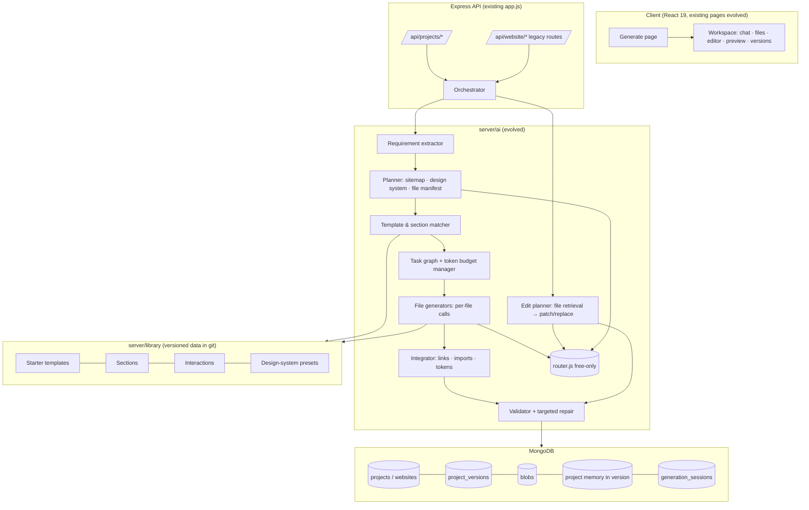
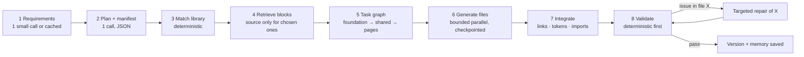

# GenWeb.ai 2.0: Hybrid Builder Blueprint

*Updated 2026-11-02 from the current `websiteBuilder-v2` working tree. Planning only: this document update does not change application behavior, configuration, dependencies, databases, deployment, or Git history. The working tree contains unrelated/uncommitted client changes from earlier work; this blueprint treats them as current local state, not as a released baseline.*

This document answers both planning briefs ("Builder Architecture and Implementation Plan" and "Intelligent Hybrid Website Builder") in one place. It does **not** repeat what is already designed in [GENWEB_AI_2_TARGET_ARCHITECTURE.md](GENWEB_AI_2_TARGET_ARCHITECTURE.md) (schemas, migration, multi-file preview, quality engine) or [GENWEB_AI_2_ROADMAP.md](GENWEB_AI_2_ROADMAP.md) (phases R0–R8). It links to them and adds what is new:

- the **hybrid engine**: starter templates, section library, interaction library;
- the **generation pipeline** for multi-file projects;
- **project memory**, the **token budget manager** and **design-system variation**;
- how all of this maps onto the existing phases and files.

**Labels:**
- `[VERIFIED]`: confirmed in the current source tree, tests, or authoritative project documentation; the file path and evidence are named.
- `[PROPOSED]`: new design.
- `[ASSUMPTION]`: needs measurement or the owner's confirmation.
- `[BLOCKED]`: waits on a prerequisite.
- `[DEFERRED]`: intentionally later.

---

## 1. Executive summary

**Today** `[VERIFIED]`: GenWeb.ai has a legacy single-file path plus a current template-backed static multi-page path. It uses one AI call or a brief-plus-generation strategy, validates and repairs output deterministically, applies targeted edits with full-rewrite fallback, and supports design-library assembly, versions, export and deployment. The current local verification baseline is **267 server tests passing**, **15 client tests passing**, client lint clean and a successful production build; the build retains a chunk-size advisory. AI remains free-tier only.

**Target** `[PROPOSED]`:

- **Complete multi-file projects:**
  - Classic: HTML/CSS/JS, several pages;
  - Advanced: React + Vite.
- **Templates and sections do the heavy lifting.** The AI plans the project, picks and customises tested building blocks, and writes only what is genuinely new. Each file is generated in its own small call that fits the free-tier limits.
- **Edits touch only the files they need.** Every change is a version that can be restored.

**Why hybrid is the right fit for us, not just a copy of competitors:**

- **The binding constraint is free-tier request size.**
  - Groq, our main verified provider, allows about **8,000 tokens per request including output** `[VERIFIED: server/ai/catalog.js limits.maxRequestTokens]`.
  - So a 3–5 page site cannot come out of one call; it must be split into tasks.
- **Reused blocks save output tokens.** A reused, tested navbar or accordion costs ~0 output tokens. The AI only adapts its content and tokens.
- **Validated blocks mean fewer repair calls.** Repairs are the most wasteful tokens.

**Readiness verdict: NEEDS ARCHITECTURAL DECISIONS.**
- R0 is not formally closed (§12).
- Seven owner decisions are open (§13).
- The first implementation step, R1 versions, does not depend on any of them and can start once approved.

---

## 2. Current system: what exists `[VERIFIED]`

### 2.1 Request flow (generate)

```mermaid
sequenceDiagram
  participant U as User (Generate.jsx)
  participant API as POST /api/website/generate
  participant C as website.controller.generateWebsite
  participant P as ai/pipeline.generateSite
  participant R as ai/router.runTask
  participant M as Free provider (Groq/Zhipu/Cloudflare)
  participant DB as MongoDB websites
  U->>API: { prompt }
  API->>C: isAuth → rateLimit(ai: 20/10min)
  C->>C: reserveDailySlot (ai_counters) → reserveCredits(50) (ledger txn)
  C->>P: generateSite(prompt, deadline 200s)
  P->>R: task "generate", maxTokens 12000
  R->>M: priority-ordered free model; clamps output to provider budget
  M-->>R: JSON line + ```html block
  R-->>P: content, usage logged (ai_calls)
  P->>P: robustExtract → replaceExternalImages → validateDocument → deterministicRepair → AI script repair (≤2 scripts)
  P-->>C: { parsed: {title, message, code} } or reason
  C->>DB: Website.create({ latestCode, conversation, slug, thumbnail* })
  C-->>U: { code, websiteId, credits }
  Note over C: on failure: refundCredits + release quota slot, 503 with reason
```

### 2.2 Module map

| Concern | File(s) | What it does today |
| --- | --- | --- |
| Routes | `server/routes/website.routes.js` | `generate`, `enhance-prompt`, list/get, `PUT /:id` (AI edit), `PATCH /:id/code` (manual save), delete, deploy, undeploy |
| Controller | `server/controllers/website.controller.js` (480 lines) | Quota + credit reservation, refunds, persistence, thumbnail extraction, deploy and public serving `/s/:slug` |
| Pipeline | `server/ai/pipeline.js` | `generateSite`, `editSite`, `enhanceIdea`, `runDocumentTask` (2 attempts), `robustExtract` |
| Strategy | `server/ai/strategy.js` | `auto` = single call (benchmarked 2026-11-01: brief costs +14% tokens, 2× requests) |
| Edit planning | `server/ai/intent.js` | `analyzeEditIntent` (regex intent: script/style/text/additive/removal + section target) → `planEdit` modes: `style_append`, `text_replace`, `section_patch`, `section_add`, `style_script_patch`, `full` |
| Patching | `server/ai/htmlPatch.js` | Balanced-tag `extractSection`, `buildSkeleton`, `patchHTML`, `insertAt` |
| Validation | `server/ai/validate.js` | `validateDocument`, `comparePatch` (regression: scripts/sections/content lost), `deterministicRepair`, `brokenScripts` |
| Prompts | `server/ai/prompts.js` | Generation/edit/repair/enhance prompts; user text quoted as data; design-token rules (`--primary`, `--bg`…) |
| Routing | `server/ai/router.js`, `catalog.js`, `keyPool.js`, `quota.js`, `config.js` | Priority + rotation per task; per-model cooldowns; provider daily caps; first-usable credential; paid fields rejected |
| Tracking | `server/ai/usage.js`, `models/ai.models.js` | `ai_calls` per call, `ai_requests` per user request (tokens, attempts, outcome) |
| Cache | `server/ai/cache.js` | `design_brief` 30 min, `enhance` 24 h |
| Credits | `server/services/credits.js`, `models/creditTransaction.model.js` | Transactional reserve/refund ledger; Razorpay grants are idempotent |
| Data | `server/models/website.model.js` | `latestCode: String`, embedded `conversation[]`, `slug` unique, `deployed`, thumbnail fields |
| Preview | `client/src/utils/previewDoc.js`, `pages/Editor.jsx` | `srcDoc` iframe, sandbox **without** `allow-same-origin`, storage shim |
| History | `pages/Editor.jsx` | Client-only undo/redo, last 20 states, lost on reload |
| Deploy | `controllers/website.controller.js` `serveDeployedSite` | Serves `latestCode` from the API origin under a CSP `sandbox` + storage shim + ribbon |

### 2.3 Strengths to keep

- **Free-only routing:**
  - capacity-aware failover;
  - honest "free capacity used up" errors with `Retry-After`;
  - never a paid fallback.
- **Credits are safe:** reserved before AI work and refunded on any failure. Retries inside one request are never double-charged.
- **Edits are surgical where possible,** with a regression gate (`comparePatch`) and a full-rewrite fallback.
- **Generated code is isolated:** opaque-origin preview; sandboxed deploy.
- **Prompt-injection hygiene:** user text is wrapped as quoted data.

### 2.4 Limits and findings

| # | Finding | Evidence | Impact |
| --- | --- | --- | --- |
| **H-1** | Legacy storage remains single-code-centric | `Website.latestCode` remains the compatibility field; current static multi-page behavior also uses `files` and page-aware routes | A first-class manifest/version model is still needed for larger projects and React mode |
| **H-2** | No server-side versions | Only `latestCode`; Editor history is client-side, 20 entries, lost on reload | A bad edit or a bad save is irreversible |
| **H-3** | **Slug generator is broken** (bug) | `generateSlug` uses `/[^a-z0-9s-]/` and `/s+/` (missing backslashes). `"Business Solutions"` → `"bu-ine-olution-"` (reproduced with node) | Ugly, unreadable public URLs. Not a security issue. Fix is one line + test; changes only **new** slugs (existing ones must stay) |
| **H-4** | Conversation embedded without bound | `conversation: [messageSchema]` grows on every edit | Document can approach MongoDB's 16 MB limit together with `latestCode` (1.5 MB cap) on long-lived projects `[ASSUMPTION: rare today]` |
| **H-5** | Only 4 AI task types | `catalog.js TASKS = generate, edit, design_brief, enhance` | Planning, file generation and repair need their own budgets and model choices |
| **H-6** | Token estimate is chars/4 | `router.estimateTokens` | Fine for budgeting; must stay conservative for the 8k Groq request budget |
| **H-7** | Edit intent is regex-only | `intent.js` | Works for single-page sections; multi-file needs file retrieval, not only section names |
| **H-8** | No template or component reuse | Every generation starts from zero | Higher tokens and more variance; no tested building blocks |

---

## 3. Target architecture `[PROPOSED]`



**Principles:**

1. **Evolve the existing code.**
   - `pipeline.js`, `router.js`, `validate.js`, `htmlPatch.js` and `intent.js` are generalised from "the document" to "a file".
   - `single_html` stays the default until each new mode passes its benchmarks.
2. **One orchestration layer for both modes.**
   - Shared: requirement extraction, planning, design system, task graph, routing, budgets, memory, versions and credits.
   - Framework-specific: file manifest templates, the per-file generator prompts, the validators (HTML/CSS/JS vs JSX/imports) and preview assembly.
3. **Plan before code. Small tasks, never one huge response.**
4. **The library is data, not AI output.**
   - Templates and sections live in the repository, are reviewed and tested, and carry licence metadata.
   - They cost no tokens to produce.

---

## 4. The hybrid library `[PROPOSED]`

### 4.1 Layout (no new dependency; JSON + source files in git)

```
server/library/
  index.json                      # generated at build/test time: metadata of everything below
  design-presets/*.json           # colour/type/spacing/radius/shadow token sets + mood tags
  templates/<id>/template.json    # starter: category tags, pages, sections per page, framework
  templates/<id>/classic/**       # HTML/CSS/JS foundation (partials marked with slots)
  templates/<id>/react/**         # React/Vite foundation (R6)
  sections/<kind>/<variant>/section.json
  sections/<kind>/<variant>/classic.html|.css|.js
  sections/<kind>/<variant>/react.jsx            # R6
  interactions/<id>/interaction.json + classic.js + react.js
```

### 4.2 Metadata (what the AI sees: a few hundred tokens, not source)

```json
{
  "id": "pricing/three-tier-toggle",
  "kind": "pricing",
  "purpose": "3 plans with monthly/yearly toggle",
  "frameworks": ["classic", "react"],
  "variants": ["cards", "table"],
  "slots": { "plans": "array<{name, price, features[], cta}>", "heading": "string" },
  "tokens": ["--primary", "--surface", "--text", "--radius"],
  "interactions": ["toggle"],
  "responsive": "stacks below 768px",
  "a11y": ["toggle is a button with aria-pressed", "AA contrast with preset tokens"],
  "deps": [],
  "license": "original, GenWeb.ai",
  "version": 1
}
```

**Rules:**

- Every block uses **only** the design-token CSS variables the prompts already require (`--primary --secondary --accent --bg --surface --text`, plus spacing/radius). Re-theming therefore needs no rewrite.
- **Licence field is mandatory:**
  - original work, or a permissive licence with attribution;
  - no copying of competitors' or proprietary templates.
- **A test per block** (`server/tests/library.test.js`):
  - parses;
  - has `alt` text and labels;
  - uses no external images;
  - the JS block passes the existing syntax check;
  - its metadata matches its slots.

### 4.3 Matching score (not by category name alone)

Each template or section gets a score:

```
score = 0.30·category + 0.20·features + 0.15·pageStructure + 0.15·framework
      + 0.10·design (mood/style tags) + 0.10·componentCoverage
```

- Each factor lies in 0–1 and is computed **deterministically** from the extracted requirements (§5.1).
- There is no AI call for matching.
- The weights are `[ASSUMPTION]`; tune them in the benchmark (§11).

| Score | Strategy |
| --- | --- |
| ≥ 0.75 **Strong** | Use the starter template; customise copy, tokens and section variants; generate only missing sections |
| 0.45–0.75 **Partial** | Assemble from sections; the AI writes the layout glue and missing sections |
| < 0.45 **Weak** | AI-first generation (like today's prompts), reusing only interactions and low-level blocks |
| **Existing project** | Never apply a template. Edit in place (§6) |

### 4.4 Avoiding "every site looks the same"

**Variation dimensions** (chosen per project, recorded in memory):
- design preset (or generated tokens);
- section variant per kind;
- page composition order;
- font pairing;
- background treatment;
- radius/shadow scale;
- motion level.

**Built-in variety:**
- At least **3 variants per common section** and **≥ 8 design presets** at launch `[PROPOSED target]`.
- **Design-system engine:** the planner picks a preset close to the brief's mood. The AI may adjust it (hue shifts, font pairing) within a contrast check; `prompts.contrastRatio` exists `[VERIFIED]`.
- **Anti-repetition:** store the user's last N presets/variants in memory and down-rank them in the next match.

**Measured** in benchmarks (§11): distinct font pairs, palettes and section variants per 10 generations. Today's benchmark reports 5–7 distinct font pairs over 7 sites `[VERIFIED: server/ai/strategy.js comment]`.

---

## 5. Generation pipeline (multi-file) `[PROPOSED]`



### 5.1 Stage 1: Requirements

- **One short call** (task `analyze`, ~600 output tokens) returning strict JSON:
  - category, audience, purpose, pages, features;
  - style, colours, fonts, framework, content facts;
  - constraints, `missing[]`.
- **Missing critical information:**
  - **Default it, don't ask.** Ask at most **one** question, only when no safe default exists.
  - Example: e-commerce payment provider. A beginner gets a non-functional "checkout" button, labelled as such.
- **Cache key:** normalised prompt, same mechanism as `ai/cache.js`.

### 5.2 Stage 2: Plan and file manifest

- **One call** (task `plan`) returning:
  - sitemap, navigation, shared components;
  - sections per page, design tokens, functional requirements;
  - **file manifest** with a purpose per file and dependency edges.
- **Validated deterministically:**
  - allowed paths and extensions;
  - ≤ N files (Classic ≤ 12, React ≤ 25 `[ASSUMPTION]`);
  - no orphan files;
  - every nav link has a page.
- The plan is shown to the user as a **checklist** (existing "plan mode" idea, roadmap R4). Beginners can just press Generate.

### 5.3 Stage 6: Task-based generation with dynamic task size

**The task graph:**

1. **foundation:** tokens CSS, base styles, shared JS/interactions; mostly library, little AI.
2. **shared:** header/nav/footer partial; one call, reused by every page.
3. **pages:** one task per page (parallel), each given the shared partial's *signature* (class names, token names), not its full source.
4. **content:** text-heavy sections; can share a call when small.
5. **validate and repair.**

**Task size** is decided by the **token budget manager** (§7.3):

```
fits(task) := estIn(task) + estOut(task) ≤ budget(model) · 0.85
estIn  = prompt template + memory summary + retrieved blocks + signatures   (chars/4, conservative)
estOut = Σ expected size per file kind (learned per project kind from ai_calls; seed: page ≈ 2,800 tok [VERIFIED order of magnitude])
if !fits: split by section group (page → page-top / page-bottom) or move a block to library reuse
```

**Execution rules:**

- **Bounded parallelism:**
  - at most 2 concurrent calls per request `[ASSUMPTION: protects the per-minute token limit; measure]`;
  - the existing pool-wide pause on rate-limit errors stays in force `[VERIFIED: keyPool coolDown]`.
- **Checkpoints:**
  - every finished file is stored in a draft version in `generation_sessions`;
  - a retry or a resume skips files already validated;
  - credits stay reserved once for the whole run (§9).
- **Deadline:** the existing 200 s request budget becomes a **job**.
  - Generation of a multi-page site may exceed one HTTP request.
  - **Decision O-3 (§13):** keep the work synchronous with streaming progress over a held connection, or use an in-process job with polling. No Redis/BullMQ, which is not approved.
  - Render's free instance sleeps and has one process, so in-process jobs must survive only within one instance lifetime. A resume uses the checkpoints.

### 5.4 Stage 7–8: Integration, validation, repair

**Deterministic checks** (reuse and extend `validate.js` per file):

- every `href`/`src` to a project file exists;
- CSS classes used in HTML exist in some stylesheet, or are flagged;
- token variables are defined once;
- JS syntax (existing check);
- **React:** imports resolve to manifest files, named exports exist, one default export per page.

**Runtime checks** in the preview iframe (client-side, opaque origin):
- console errors;
- uncaught exceptions;
- broken links, posted back via `postMessage`.

**Repair:**
- only the affected file, or its dependency group;
- max **2** repair calls per run (today: ≤ 2 broken scripts `[VERIFIED]`).
- After that, keep the last valid version and report the issue. There is no unbounded loop.

---

## 6. Smart editing `[PROPOSED, generalises VERIFIED intent.js]`

**Flow:**

```
prompt → intent (existing analyzeEditIntent + file-level targets)
       → retrieve: memory.fileIndex (path → summary, sections, classes, tokens) → top-k files
       → plan ops: [{op:update, path, mode: section_patch|style_append|text_replace|full_file}, {op:create,…}]
       → per-file patch with existing modes → comparePatch per file + cross-file link check
       → new version; unrelated files are byte-identical (verified by blob hash)
```

**Examples:**

| Request | What happens |
| --- | --- |
| "Navbar background dark blue" | Retrieve `tokens.css` + the nav partial. If a token controls it, change **1 token** (`style_append`); otherwise patch the nav section. One file changes. |
| "Add a pricing page" | Plan `create pricing.html` from the pricing section variant matching the design preset, `update` nav partial + footer links. Three files change; others stay untouched. |

**When a full file is regenerated:**
- the file's patch fails `comparePatch` twice;
- the request restructures the file;
- or the file is < 2 KB (cheaper than a patch).

**When the whole project is regenerated:**
- only on explicit user request ("redo the whole site");
- it always creates a new version, so the old one is one click away.

---

## 7. Token efficiency `[PROPOSED]`

### 7.1 Context (never the whole project)

A call receives, in order of need:

1. a 150–300-token **project summary**;
2. the **design tokens**;
3. the manifest;
4. **summaries** of related files;
5. the **full source** only of files being changed;
6. the last 3 conversation turns, plus a rolling summary.

### 7.2 Project memory

- **Stored with each version:** a `memory` object inside the immutable version record.
  - This avoids a new collection: the version is the unit of truth.
  - Fields: purpose, framework, sitemap, design system, decisions, features, deps, `fileIndex`, known issues, user preferences, last good version.
- **Synchronisation:**
  - after every accepted change, recompute `fileIndex` entries deterministically (ids, classes, links, exports) for changed files only;
  - an AI summary is refreshed **lazily**, only when a file changed by > 30% `[ASSUMPTION]`, using a cheap model.

### 7.3 Token budget manager

Per model, `budget = min(contextWindow, provider.limits.maxRequestTokens)`; Groq 8k is `[VERIFIED]`. Other providers' limits are `[ASSUMPTION]` until observed from response headers, following the existing practice in `catalog.js` comments.

**Inputs:**
- estimated input and output;
- remaining request deadline;
- reserved repair budget (≥ 20% of the run);
- the user's credit balance;
- the per-user daily request cap (existing `perUserDailyRequests`).

**Outputs:**
- split / merge / reuse-from-library decisions;
- refuse early with a clear message when even the minimal plan cannot fit.

### 7.4 Model routing

**New task types:** `analyze`, `plan`, `file_generate`, `file_edit`, `repair`, `summarize`, added to `TASKS` with per-task priorities and minimum outputs.

**Rules** (all already enforced `[VERIFIED]`):
- free tier only;
- one account per provider;
- no key rotation to bypass limits;
- honest exhaustion errors;
- credentials never leave the server.

**Planned choice:**
- small/fast models for `analyze`/`summarize`;
- the strongest verified model for `file_generate`/`plan`;
- `[ASSUMPTION]` until benchmarked.

### 7.5 Measured, not claimed

`ai_requests` already stores tokens and attempts per request `[VERIFIED]`. Add per-phase totals (`generation_sessions.phases`, Target Architecture G.1). The headline metric is **tokens per successful, validated project**.

---

## 8. Modes, preview and security

| | Classic (R2) | Advanced (R6) |
| --- | --- | --- |
| Files | `*.html`, `assets/css/*.css`, `assets/js/*.js`, `assets/img/*` | `package.json`, `index.html`, `src/main.jsx`, `src/App.jsx`, `src/pages/*`, `src/components/*`, `src/styles/*` |
| Reuse | Partials via slot markers; build step inlines them at save/deploy time | Real components with props |
| Preview | Assemble into one `srcDoc` (Target Architecture B.4) in the existing opaque-origin sandbox | **Decision O-5:** `esbuild-wasm` in a worker (new dependency) **or** native ES modules + import maps (no dependency, lower fidelity). WebContainers rejected (licence) |
| Validation | Links, classes, tokens, JS syntax, runtime console | + import graph, exports, JSX parse (needs a parser: same decision O-5) |
| Deploy | `/s/:slug/*` from the API origin under the existing CSP sandbox | Static build output, same serving model |

**Security (additions to what exists):**

- **Path rules:**
  - normalise paths;
  - reject `..`, absolute paths, backslashes and dotfiles;
  - extension allow-list;
  - ≤ 1.5 MB per file (existing cap), ≤ 5 MB per project `[PROPOSED]`.
- **Sanitising:** SVG `<script>`/`on*` stripped; external images handled by the existing `replaceExternalImages`.
- **Preview origin:** keep **no `allow-same-origin`**. React preview runs in the same sandbox; the bundler worker never gets app cookies.
- **Deploy origin:**
  - the sites still share the API origin (mitigated by the CSP `sandbox` → opaque origin) `[VERIFIED]`;
  - a separate domain for user sites is the stronger long-term fix, **decision O-6**.
- **Dependencies (React mode):** a package allow-list by name and exact version; no install scripts run anywhere on our servers.
- **Rate limits:** the existing per-user AI limiter (20 per 10 min) counts a multi-file run as **one** request; its internal calls are bounded by the budget manager.

---

## 9. Data, versions and credits

**Data:** adopt Target Architecture **G.1–G.3** as the storage design:
- content-addressed gzip blobs in MongoDB;
- immutable `project_versions` with a file manifest;
- lazy and batch migration;
- dual write to `latestCode` during transition.

**This blueprint adds only:**
- `project_versions.memory` (§7.2) instead of a separate memory collection;
- `project_versions.library` = `[{ blockId, version }]`, so a project records which templates and sections it was built from (licence traceability, future block updates);
- `generation_sessions.checkpoints` = per-file status, for resume (§5.3).

**Storage:**
- MongoDB stays the store; no object storage until G.4 sizing shows the need.
- Atlas M0 (512 MB) is the hard limit, **decision O-7**.

**Credits** (existing ledger untouched; no payment logic change):
- **One reservation per user action:** generate project, or one edit request. All internal calls, retries and repairs are covered by it, so nothing is charged twice.
- **Price:** **Decision O-4.** Keep 50 per generation/edit, or scale by plan size (e.g. pages), shown before running.
- **Failure:** refund if no valid version was produced. If some files are valid but the run stopped:
  - keep the checkpoint;
  - charge **nothing** until the user resumes and it completes `[PROPOSED policy]`.

---

## 10. Workspace UX

**Reuse** `Editor.jsx` (chat, preview, code view, undo/redo, deploy) and `Generate.jsx`.

**Additions, in order:**
1. **Versions panel** (R1): server history replaces the 20-step client history; restore = new version.
2. **Plan checklist and progress:** per-file status during generation.
3. **File explorer and per-file editor** (R3): developers only; beginners never need it. Default view = chat + preview.
4. **Diagnostics tab:** validator and runtime-console results, with "fix this" buttons that run a targeted repair.
5. **Responsive viewport switcher:** already exists (desktop / tablet 768px / mobile 375px) `[VERIFIED: client/src/pages/Editor.jsx]`. Reuse it.

**Export:** ZIP (R5), with no new dependency `[ASSUMPTION: a store-only ZIP writer in ~100 lines]`.

---

## 11. Benchmarks

**Extend the existing harness** (`benchmarks/2026-11-01*` used real free calls with recorded results `[VERIFIED]`):
- the 12 task types from the brief: restaurant, portfolio, e-commerce, SaaS, dashboard, booking, multi-page business, experimental design, style edit, feature add, responsive fix, runtime-error repair;
- current single-file engine vs hybrid;
- **same prompts, same models, same day, ≥ 3 runs each**.

**Metrics:**
- success; build/validation pass; missing files;
- requirements met (checklist per prompt);
- visual consistency (token reuse across pages); responsive check (existing mobile rules);
- edit accuracy; regressions (unchanged files byte-identical);
- input/output/repair tokens; latency;
- **tokens per successful project**; template reuse rate.

**Acceptance gates** `[PROPOSED; thresholds set from the first baseline run, not invented now]`:
- the hybrid must **match or beat** baseline success on single-page tasks before becoming the default;
- multi-page tasks must reach a working, link-complete site in ≥ 80% of runs `[ASSUMPTION target]`;
- an edit must change only the planned files in 100% of runs.

**Competitor patterns** (public behaviour only; no claims about their internals):
- **Lovable, Bolt.new, v0 and Replit Agent** all show a **plan → files → live preview → chat edits → versions/restore** workflow.
- **v0** builds on a public component system (shadcn/ui).
- **Bolt.new** runs projects in StackBlitz WebContainers (a commercial licence for production use).

**Our differentiators** are not "better models": they are ₹0 operation, verified/reversible edits and library-backed consistency. Superiority is not claimed until benchmarks show it.

---

## 12. Roadmap mapping

The existing order stays: **R0 → R1 → R4 → R2 → R3 → R5 → R7 → R6 → R8.**

| Phase | Hybrid work added | Key files | Exit criteria |
| --- | --- | --- | --- |
| **R0** (open) | Fix H-3 slug bug (tiny); close owner actions. The new separate v2 stack deployed 2026-11-02 covers "staging/separate DB/new Firebase" in practice, but its AI keys and the Razorpay test webhook are still missing | `controllers/website.controller.js`, tests | Google login E2E ✅ (done 2026-11-02 on v2 stack); webhook credited once; AI generation works on v2 stack |
| **R1** | Versions + blobs + restore; `memory` and `library` fields reserved in the schema | `models/*`, existing `server/services/versions.js`, Editor versions panel | Every change creates a version; restore works; current 267 server tests remain green |
| **R4** | Requirement extractor + plan checklist + deterministic requirement checks (single-file first); task types `analyze`/`plan` | `ai/requirements.js`, `ai/plan.js`, `prompts.js`, `catalog.js` | Plan shown and followed; tokens measured vs baseline |
| **R2** | **Classic multi-file + library v1** (≥ 8 presets, ≥ 3 variants × 10 section kinds, 6 interactions, 4 starters); matcher; task graph; budget manager; per-file edit; multi-file preview and deploy | `server/library/**`, `ai/project/*`, `services/projectFiles.js`, `client/src/utils/assemblePreview.js` | Benchmark gates in §11 |
| **R3** | Explorer, per-file editor, diagnostics tab | `client/src/pages/Editor.jsx` → components | Developer edits round-trip as versions |
| **R5** | ZIP export, GitHub push | | Exported Classic site runs from disk |
| **R7** | Forms and data features | | |
| **R6** | **React + Vite mode** reusing the whole orchestration; React variants of library blocks | depends on decision O-5 | Builds and previews 3 benchmark apps |
| **R8** | Collaboration | | |

**MVP** = R1 + R2 Classic with library v1.
**Quality** = R4 + diagnostics.
**Advanced** = R6.
**Scale** = job queue, separate user-site domain and object storage, all of which need cost approval.

**100K concurrent users:** not supported by the current infrastructure (Render free instance, Atlas M0, free AI quotas). No claim is made. It needs workload assumptions, load tests and a paid-infrastructure budget decision.

---

## 13. Open owner decisions

| ID | Decision | Recommendation |
| --- | --- | --- |
| O-1 | Approve starting **R1 (server versions)** now, in parallel with closing R0 owner actions | Yes: R1 does not depend on deploy-side R0 items |
| O-2 | Fix slug bug H-3 now (only new slugs change) | Yes, tiny and tested |
| O-3 | Long generation: held connection with progress vs in-process job + polling | In-process job + polling (survives client reloads); no new infra |
| O-4 | Credit price for multi-page generation | Show cost from the plan before running; 50 + 10 per extra page `[ASSUMPTION]` |
| O-5 | React preview/bundling: `esbuild-wasm` (dependency) vs import maps (none) | Decide at R6, after Classic ships |
| O-6 | Separate domain for deployed user sites | Before public launch |
| O-7 | Atlas tier beyond M0 when versions grow | Measure after R1 (G.4) |

## 14. Top risks

| Risk | Mitigation |
| --- | --- |
| Free models are weaker at cross-file consistency | Library blocks + shared-partial signatures + deterministic link and class checks |
| Multi-call runs hit per-minute limits | Budget manager, ≤ 2 parallel calls, pool pause, checkpoints and resume |
| Render free instance sleeps mid-job | Checkpoints; resume without recharging |
| Template sameness | Variant/preset rotation and anti-repetition memory; measured in benchmarks |
| Migration of existing sites | Target Architecture G.3: lazy, idempotent, dual-write, dry-run batch, backup first |
| Storage on M0 | Gzip blobs, version retention (G.2), measure after R1 |

**Rollback:** every phase ships behind `kind`/feature flags with `single_html` as the default. Dual write keeps the old code path working, so rolling back the application release loses no data.

---

## 15. Next implementation step (awaiting approval)

**Recommended first build task: R1 (server-side versions).** It is the foundation everything else needs, and it is small enough to finish and test in one step:

- new `blobs` + `project_versions` (Target Architecture G.1);
- `services/versions.js` (create, list, get, restore);
- hook into generate / AI edit / manual save / deploy;
- lazy migration of existing sites on open;
- Editor versions panel;
- tests;
- no new dependency.

Together with the H-3 slug fix.
